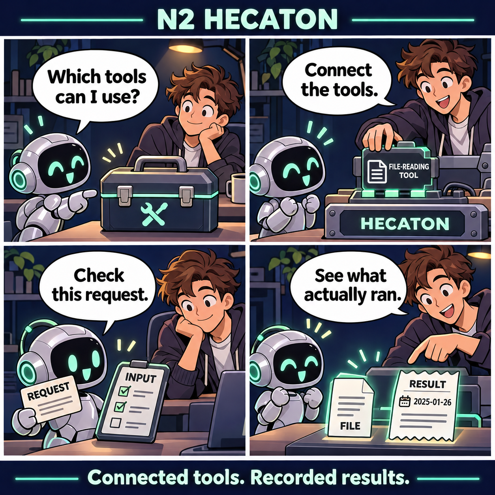
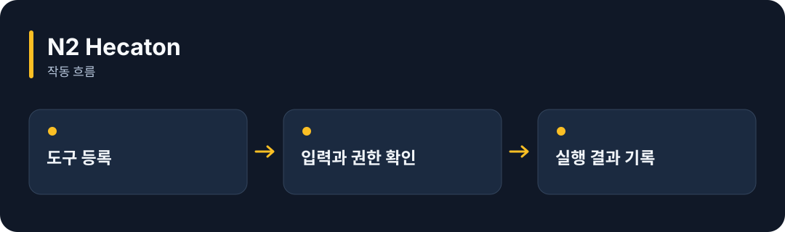

# N2 Hecaton

**AI가 쓸 도구를 한곳에 등록하고, 호출한 내용과 실행 결과를 기록합니다.**

[](https://github.com/choihyunsus/n2-hecaton/releases/tag/v1.0.1) [](https://github.com/choihyunsus/n2-hecaton/blob/main/docs/reference.ko.md) [](https://github.com/choihyunsus/n2-hecaton/blob/main/LICENSE)

[English](README.md)

<p align="center">
  
</p>

사용할 도구를 등록하고 → 요청 내용을 검사해 → 도구를 실행하고 → 실제 실행 결과를 기록합니다.

기능을 이야기로 표현한 만화입니다. 실제 앱 화면은 아닙니다.

<details>
<summary>동작 흐름 펼쳐 보기</summary>



</details>

## 이런 때 사용하세요

파일 읽기나 외부 서비스 조회 같은 기능을 AI에 연결하고, 어떤 요청이 실제로 끝났는지 확인할 때 사용하세요.

사용할 함수나 MCP 서버를 직접 등록합니다. 실행 결과가 불확실한 작업은 실제 결과를 확인하고 복구합니다. 운영체제 권한은 연결한 앱이 관리합니다.

## 처음 실행하기

터미널에서 `node --version`을 실행해 Node.js 22 이상인지 확인하세요. 아래 명령은 새 연습 폴더를 만들고 GitHub 배포 파일을 설치합니다. 예제 파일과 DB도 이 폴더에 두면 경로를 따라가기 쉽습니다.

```sh
mkdir n2-hecaton-demo
cd n2-hecaton-demo
npm init -y
npm install https://github.com/choihyunsus/n2-hecaton/releases/download/v1.0.1/n2-hecaton-1.0.1.tgz
```

설치 중 SQLite 빌드 오류가 나오면 운영체제에 맞는 C/C++ 빌드 도구가 필요할 수 있습니다. 자세한 환경 조건은 [설치 참고](https://github.com/choihyunsus/n2-hecaton/blob/main/docs/reference.ko.md)에 있습니다.

아래 내용을 `demo.mjs`로 저장하세요. 파일은 방금 설치 명령을 실행한 폴더에 둡니다.

```js
import { Hecaton } from 'n2-hecaton';
const tools = new Hecaton({
  dbPath: './demo.db', project: 'demo', agent: 'assistant',
  tools: [{
    name: 'echo', version: '1', description: 'Return the supplied text', readOnly: true,
    inputSchema: { type: 'object', properties: { text: { type: 'string' } }, required: ['text'], additionalProperties: false },
    execute: (args) => ({ success: true, output: args.text }),
  }],
});
try {
  const receipt = await tools.execute({
    requestId: 'hello-1', sessionId: 'demo-1',
    tool: 'echo', arguments: { text: 'Hello!' },
  });
  console.log(receipt.result.output, receipt.cached);
} finally {
  await tools.close();
}
```

```sh
node demo.mjs
```

첫 실행에 `Hello! false`가 출력됩니다. 같은 요청을 다시 실행하면 저장된 결과를 사용하므로 `cached` 값이 `true`가 됩니다.

## Soul과 함께 쓰기

여러 N2 모듈을 연결할 때 같은 `mimir.db` 파일을 지정하세요. `project`는 작업 이름, `agent`는 계속 사용할 AI 이름입니다. 같은 작업의 기록을 이어 쓰려면 이 값들을 맞춥니다. 단독 사용도 같은 필드 구조를 사용합니다.

## 다음 단계와 상세 안내

[전체 사용 안내](https://github.com/choihyunsus/n2-hecaton/blob/main/docs/reference.ko.md)에서 실제 앱 연결, API, 지원 범위, 복구 절차와 검증 범위를 확인할 수 있습니다. [배포 파일](https://github.com/choihyunsus/n2-hecaton/releases/tag/v1.0.1)에는 설치할 버전과 변경 설명이 있습니다.

처음 나오는 용어는 이렇게 읽으면 됩니다. **MCP**는 AI 앱의 도구 연결 방식, **DB**는 저장 파일, **호스트**는 이 모듈을 연결해 실행하는 앱입니다.

사용·재배포 조건은 [라이선스](https://github.com/choihyunsus/n2-hecaton/blob/main/LICENSE)를 확인하세요. 의존 모듈에는 별도 조건이 적용될 수 있으며, 상업 이용 조건은 상세 안내에 함께 설명되어 있습니다.
