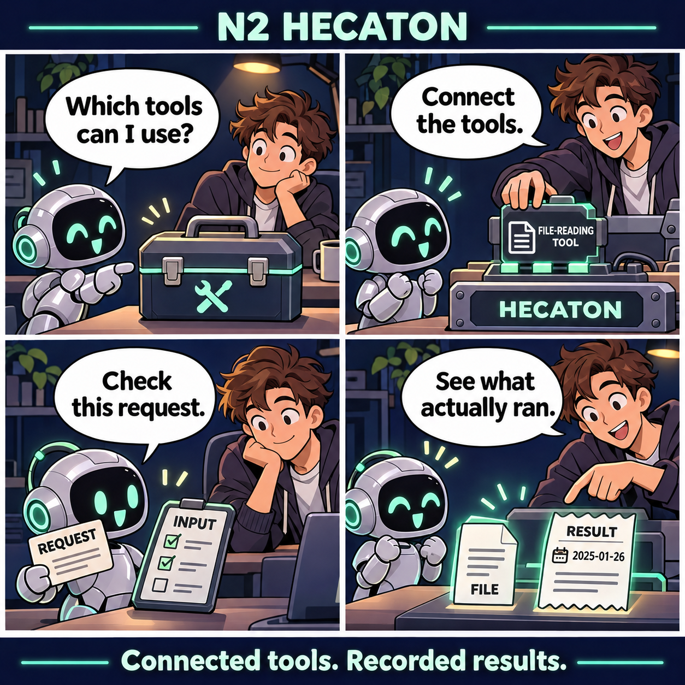
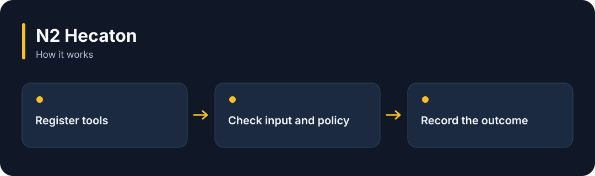

# N2 Hecaton

**Register the tools an AI can use, and keep a record of each request and its result.**

[](https://github.com/choihyunsus/n2-hecaton/releases/tag/v1.0.1) [](https://github.com/choihyunsus/n2-hecaton/blob/main/docs/reference.md) [](https://github.com/choihyunsus/n2-hecaton/blob/main/LICENSE)

[한국어](README.ko.md)

<p align="center">
  
</p>

Register the tools an AI can use, and keep a record of each request and its result.

A story illustrating the feature, rather than a screenshot of the app.

<details>
<summary>View the workflow</summary>



</details>

## When to use it

Connect operations such as reading files or looking up an external service, and inspect which requests actually finished.

Register your functions or selected MCP servers. Resolve uncertain operations by checking the real outcome. The connected app manages operating-system permissions.

## Try it

Run `node --version` in a terminal and check for Node.js 22 or later. These commands create a fresh practice folder and install the GitHub release. Keep the example file and database in this folder.

```sh
mkdir n2-hecaton-demo
cd n2-hecaton-demo
npm init -y
npm install https://github.com/choihyunsus/n2-hecaton/releases/download/v1.0.1/n2-hecaton-1.0.1.tgz
```

If installation reports a SQLite build error, you may need your platform’s C/C++ build tools. See the [installation reference](https://github.com/choihyunsus/n2-hecaton/blob/main/docs/reference.md) for platform requirements.

Save the following as `demo.mjs` in the folder where you ran the install command.

```js
import { Hecaton } from 'n2-hecaton';
const tools = new Hecaton({
  dbPath: './demo.db', project: 'demo', agent: 'assistant',
  tools: [{
    name: 'echo', version: '1', description: 'Return the supplied text', readOnly: true,
    inputSchema: { type: 'object', properties: { text: { type: 'string' } }, required: ['text'], additionalProperties: false },
    execute: (args) => ({ success: true, output: args.text }),
  }],
});
try {
  const receipt = await tools.execute({
    requestId: 'hello-1', sessionId: 'demo-1',
    tool: 'echo', arguments: { text: 'Hello!' },
  });
  console.log(receipt.result.output, receipt.cached);
} finally {
  await tools.close();
}
```

```sh
node demo.mjs
```

The first run prints `Hello! false`. Repeating the same request uses the saved result and sets `cached` to `true`.

## Using it with Soul

Point connected N2 modules at the same `mimir.db` file. `project` names the work and `agent` names the AI identity you will keep using. Match those values to continue working with the same records. Standalone use follows the same field layout.

## Next steps and reference

The [full reference](https://github.com/choihyunsus/n2-hecaton/blob/main/docs/reference.md) covers app integration, APIs, supported features, recovery and validation. The [release page](https://github.com/choihyunsus/n2-hecaton/releases/tag/v1.0.1) contains the installable version and release notes.

A few terms used in the reference: **MCP** connects tools to an AI app, a **database** stores records, and the **host** is the app that connects and runs this module.

Review the [license](https://github.com/choihyunsus/n2-hecaton/blob/main/LICENSE) for use and redistribution. Dependencies can have their own terms, including commercial-use conditions described in the reference.
